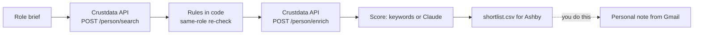

# Defense Prime Alumni Sourcer (Open Source, Ashby-Ready Shortlist)

**An open-source Python tool that finds US engineers who used to work at a big defense prime, confirms they now work at a small company, scores them against the role you are hiring for, and writes a shortlist you can load into an Ashby project.**

Defense tech startups want people who have already shipped for Lockheed Martin, RTX, Boeing, Northrop Grumman and the rest. Most of those people never show up in a job-title search, because their title today says nothing about their past employer. This tool searches on the past employer instead, then re-checks every result in code. [Crustdata](https://crustdata.com) is the people data layer ([API docs](https://docs.crustdata.com)).


## How it works



1. **Search.** One `POST /person/search` call: past employer website in the list of primes, a past title containing "Engineer", located in the United States, current employer with 2 to 500 people, current seniority not CXO or owner.
2. **Re-check in code.** The search filters can each match a different role in someone's history. `qualify()` re-checks on one past role: it is a prime, the title is an engineering title, and it has ended. It also drops people back at a prime, people with no real current job, nonprofits, schools and self-employed.
3. **Enrich.** The top of the list goes through `POST /person/enrich` so the current role and skills are fresh. Anyone who no longer passes the rules is dropped.
4. **Score.** A 0-100 keyword score against your role brief (title, skills, prime work, years at the prime, clearance-style language). With `--claude`, Claude scores each profile against the brief instead and the keyword score is the fallback.
5. **Output.** `out/shortlist.csv` and `out/shortlist.json`, plus an optional Slack message. Load the CSV into an Ashby project, then write each person a personal note yourself. The tool never contacts anyone.

## Quickstart

Requires Python 3.9+. No dependencies for the core tool.

```bash
git clone https://github.com/mhimed-crustdata/defense-prime-alumni-sourcer
cd defense-prime-alumni-sourcer
make setup        # creates .env, then add your CRUSTDATA_API_KEY
make demo         # never posts to Slack
make run          # posts to SLACK_WEBHOOK_URL
make test         # unit tests, no network
```

Pick the role on the command line:

```bash
python3 sourcer.py --role "firmware engineer, RTOS, embedded C, avionics" --top 30 --min-score 60
```

## Configuration

| Variable | Default | What it does |
|---|---|---|
| `CRUSTDATA_API_KEY` | required | Your Crustdata API key. Read from the environment only |
| `ROLE_BRIEF` | embedded software engineer C++ real-time systems | The role you are hiring for (same as `--role`) |
| `MIN_SCORE` | `50` | Drop candidates scoring below this |
| `SLACK_WEBHOOK_URL` | empty | Slack incoming webhook. Empty means no Slack post |
| `ANTHROPIC_API_KEY` | empty | Optional Claude scoring with `--claude` |
| `ANTHROPIC_MODEL` | `claude-opus-5-5` | Model for the optional Claude step |

Edit the `PRIMES` table at the top of `sourcer.py` to add or remove employers. Output files in `out/` contain personal data and are git-ignored.

## Example output

A real run on 2026-10-21 against the live API with the default settings, reading 200 profiles. Individuals are not shown.

```json
{
  "profiles_matching_the_search": 33236,
  "profiles_read": 200,
  "passed_all_rules": 149,
  "dropped_by_rules": {
    "prime role and engineer title were on different roles": 18,
    "current employer too large": 17,
    "current employer is a nonprofit, school or partnership": 11,
    "no real current job": 5
  },
  "passed_by_past_prime": {
    "Lockheed Martin": 34,
    "RTX / Raytheon": 28,
    "Northrop Grumman": 25,
    "Boeing": 23,
    "L3Harris": 14,
    "BAE Systems": 9,
    "General Dynamics": 6,
    "other": 10
  },
  "passed_by_current_company_size": {
    "2-10": 19,
    "11-50": 35,
    "51-200": 60,
    "201-500": 35
  }
}
```

About one in four profiles the search returns fails the same-role re-check. That is why the rules live in code and not in the filter.

What the Slack message looks like (redacted):

```text
:dart: 12 defense-prime alumni for review
• *[Name]* (86) [Past title] at [Prime] -> [Current title] at *[Company]* <[profile URL]|profile>
```

## How to build a defense tech recruiting agent

1. **Define the signal as data.** "Past employer is a prime" is a field, not a job title.
2. **Choose the documented Crustdata call and filters.** `POST /person/search` on `experience.employment_details.past.company_website_domain`, the location country and the current headcount range.
3. **Write the rules in code, not in a prompt.** Re-check nested matches on one role.
4. **Only shortlist what's new.** Seen people are stored in `.state/seen.json`.
5. **Use the model for the judgment, not the list.** Claude scores fit against your brief. The candidate list comes from data.
6. **Push it where people work.** CSV into Ashby, a Slack message for the team, then a personal note from Gmail.

## FAQ

**How to recruit engineers for defense tech?**
Search on where people used to work, not on what their title says today. This tool pulls US engineers whose past employer is a defense prime and who now work at a small company, so you start from people who already know the work.

**Why does the code re-check the search results?**
Nested filters on work history can match different roles. A profile can match "prime" on one job and "Engineer" on another. `qualify()` requires both on the same ended role, and every rule has a unit test.

**Does it check security clearances?**
No. Clearance status is not a data field here. The score only rewards clearance-style language (for example "TS/SCI") in the profile text, which is a hint and not a verification.

**Does it contact anyone?**
No. It writes a CSV and optionally posts to your own Slack webhook. Outreach stays with the recruiter.

**Is Claude required?**
No. It is optional and off unless `ANTHROPIC_API_KEY` is set and you pass `--claude`.

**Which Crustdata endpoints does it use?**
`POST /person/search` and `POST /person/enrich` on API version `2025-11-01`. See the [Crustdata API docs](https://docs.crustdata.com).

## Project layout

```text
sourcer.py          # search, rules, enrich, score, output
crustdata_api.py    # tiny Crustdata client (stdlib only)
notify.py           # optional Slack + Claude
tests/              # unit tests, no network
```

## License

MIT. See [LICENSE](LICENSE). Data layer: [Crustdata](https://crustdata.com) ([docs](https://docs.crustdata.com)).
